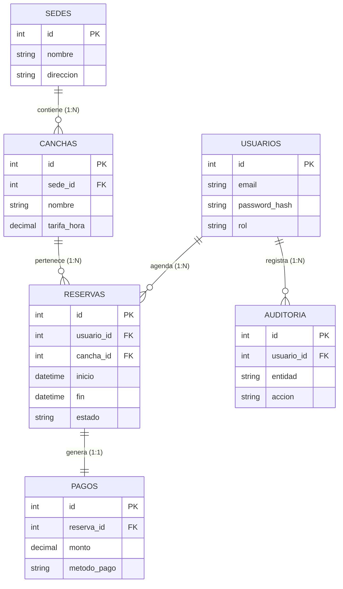
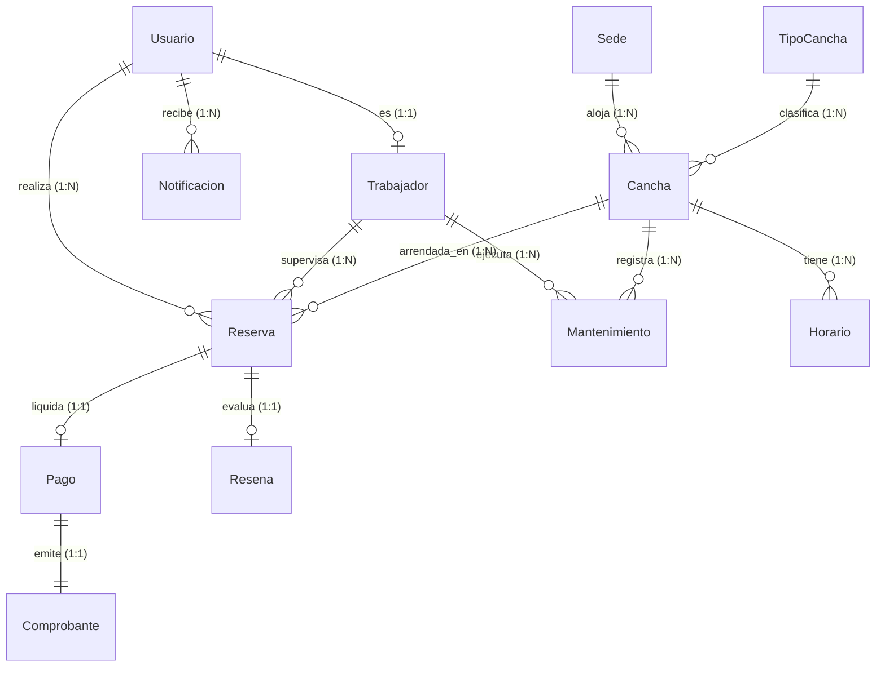
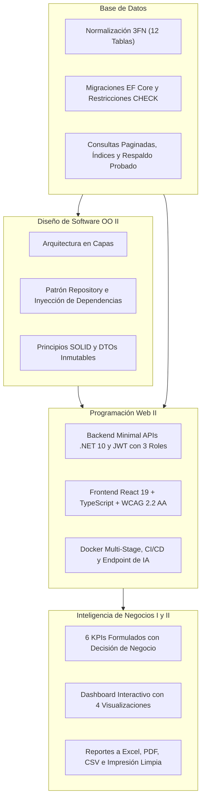

# INFORME_INTEGRADOR_HITO_1_AL_4.md
# INFORME TÉCNICO INTEGRADOR: SISTEMA DE GESTIÓN Y RESERVA DE CANCHAS DEPORTIVAS
### Evaluación 3 — Integrador de Desarrollo de Software (Hitos 1, 2, 3 y 4)
**Asignatura:** Lenguaje de Programación Web II  
**Carrera:** Ingeniería / Técnico en Desarrollo de Software  
**Integrantes:**
- Rodrigo Tapia
- Gustavo Jaramillo
- Benjamin Garcia

---

## 1. Introducción y Dominio del Problema

### 1.1. Contexto y Problema a Resolver
En la industria de recintos y complejos deportivos, la gestión tradicional de arriendos mediante llamadas telefónicas, mensajes de WhatsApp o cuadernos manuales genera fallas críticas en la operación diaria:
- **Horarios topeados y solapamientos:** Arriendo duplicado de la misma cancha por falta de validación transaccional concurrente.
- **Pérdida financiera por "No-Show":** Clientes que reservan y no asisten sin confirmación ni registro de anticipos, dejando la infraestructura ociosa.
- **Descuadre de caja:** Inconsistencia entre los arriendos jugados, pagos recibidos (efectivo, tarjetas, transferencias) y comprobantes emitidos.
- **Pérdida de clientes por lentitud de respuesta:** Ausencia de un portal de autoservicio donde el cliente visualice en vivo los bloques disponibles y reserve inmediatamente.

### 1.2. Objetivo y Alcance
Construir una solución integral de software web que cubra de punta a punta el flujo de negocio:
1. **Autoservicio para Clientes:** Consulta en vivo de sedes y canchas, cotización y agendamiento por bloques horarios continuos de 1 a 3 horas (08:00 a 00:00 hrs).
2. **Control Operativo en Terreno para Trabajadores:** Monitoreo en vivo de ocupación, recepción de jugadores, confirmación y cambio de estados.
3. **Gobierno y Analítica para el Administrador:** Catálogo de sedes y canchas, dashboard de BI con 6 KPIs clave, asistente de IA para recomendaciones comerciales, exportación de reportes a Excel, PDF y CSV, e impresión limpia.
4. **Despliegue y Arquitectura Empresarial:** Backend en ASP.NET Core 10 Minimal APIs, Frontend en React 19 + TypeScript + Vite, base de datos normalizada (3FN) en SQL Server con migraciones versionadas y empaquetamiento contenerizado con Docker Compose y pipeline CI/CD en GitHub Actions.

---

## 2. Hito 1: Propuesta, Diseño y Requerimientos

### 2.1. Roles de Usuario y Matriz de Permisos (RBAC)
| Rol | Alcance y Permisos en el Sistema |
| :--- | :--- |
| **Cliente (Jugador)** | Vista simplificada. Puede registrarse, explorar canchas, simular tarifas, crear reservas por bloques (1 a 3 horas), consultar únicamente sus propias reservas y cancelar arriendos pendientes. Protección BOLA estricta. |
| **Trabajador (Recepción)** | Panel operativo. Supervisa la agenda global del complejo, asigna su atención directa a los partidos (`Asignarme`), aprueba/confirma reservas, finaliza arriendos y reporta canchas en `Mantenimiento`. |
| **Administrador (Gerente)** | Control total. Todo lo anterior más: CRUD de sedes y canchas, gestión de tarifas, eliminación física de reservas, acceso al Dashboard de Business Intelligence, generación de análisis con IA y exportación de reportes contables. |

### 2.2. Requerimientos Funcionales (RF)
- **RF-01 (Autenticación y Sesión):** Registro seguro de usuarios y login con emisión de tokens JWT HMAC-SHA256 con tiempo de expiración y claims de identidad y rol.
- **RF-02 (Gestión de Infraestructura):** Creación, edición, activación y desactivación de sedes deportivas, tipos de cancha y canchas físicas.
- **RF-03 (Reserva por Bloques Horarios):** Selección de fecha, cancha y duración (1, 2 o 3 horas) entre 08:00 y 00:00 hrs, con cálculo automático de hora de término y total a pagar.
- **RF-04 (Control de Ocupación en Vivo):** Visualización en tiempo real del estado de cada cancha (`Disponible`, `En Juego`, `Ocupada`, `Mantenimiento`) según la hora del servidor.
- **RF-05 (Flujo y Ciclo de Vida con Estados):** Máquina de estados finita (`Pendiente` $\rightarrow$ `Confirmada` $\rightarrow$ `Completada` / `Cancelada`) con bloqueo de transiciones inválidas y estados terminales.
- **RF-06 (Auditoría y Trazabilidad):** Registro en base de datos de quién creó o modificó cada registro principal, con marcas de tiempo (`FechaCreacion`, `UsuarioId`, `TrabajadorId`).
- **RF-07 (Dashboard de Inteligencia de Negocios):** Cálculo y presentación de 6 métricas clave con filtros dinámicos.
- **RF-08 (Reportes Multi-formato):** Generación de 3 reportes (operativo, gerencial y parametrizable) exportables a Excel (.xlsx), PDF y CSV, con soporte de impresión `@media print`.
- **RF-09 (Integración de IA Externa):** Endpoint que consume API de Inteligencia Artificial para diagnosticar la operación del complejo y recomendar optimizaciones tarifarias.

### 2.3. Requerimientos No Funcionales (RNF)
- **RNF-01 (Seguridad y OWASP):** Rate Limiting en login (máximo 5 intentos/minuto $\rightarrow$ HTTP 429), protección BOLA (HTTP 403), protección contra Broken Authentication, Mass Assignment y cabeceras de seguridad estrictas.
- **RNF-02 (Accesibilidad WCAG 2.2 Nivel AA):** Interfaz navegable al 100% mediante teclado, foco visible, contraste superior a 4.5:1, etiquetas en todos los formularios, regiones semánticas y compatibilidad con lectores de pantalla (NVDA/VoiceOver).
- **RNF-03 (Diseño Responsive Mobile-First):** Interfaz adaptable desde 360px hasta 1440px sin desplazamiento horizontal, tablas con desplazamiento interno y elementos táctiles mínimos de 24x24 px (recomendado 44x44 px).
- **RNF-04 (Rendimiento y Disponibilidad):** Respuestas de API inferiores a 200ms en consultas indexadas, healthcheck `/health` continuo y arranque de todo el sistema en un comando (`docker compose up`).

### 2.4. Historias de Usuario Priorizadas con Criterios de Aceptación
1. **HU-01: Agendamiento de Reserva por Bloques Horarios**
   - *Como* Cliente registrado, *quiero* elegir sede, cancha, fecha, hora de inicio y duración de 1 a 3 horas, *para* asegurar mi turno con cálculo automático del precio.
   - *Criterios de Aceptación:*
     - Solo permite bloques de 1, 2 o 3 horas completas.
     - Horario válido entre 08:00 y 00:00 hrs.
     - Si la cancha ya está reservada en ese horario, devuelve `HTTP 409 Conflict` con mensaje claro.
2. **HU-02: Búsqueda y Filtrado de Canchas**
   - *Como* Cliente o Trabajador, *quiero* filtrar canchas por sede y deporte, *para* ubicar rápidamente el terreno disponible.
   - *Criterios de Aceptación:*
     - Búsqueda reactiva sin recargar la página.
     - Muestra tipo de superficie, tarifa por hora y estado operativo.
3. **HU-03: Control Operativo de Ocupación en Tiempo Real**
   - *Como* Trabajador de terreno, *quiero* ver el estado actual de cada cancha, *para* gestionar el ingreso de los jugadores.
   - *Criterios de Aceptación:*
     - Distingue canchas Libres, En Juego y en Mantenimiento según reloj del servidor.
4. **HU-04: Gestión del Flujo de Reserva en Recepción**
   - *Como* Trabajador, *quiero* confirmar una reserva o asignarme su atención, *para* registrar el ingreso del grupo.
   - *Criterios de Aceptación:*
     - Botón "Asignarme" vincula el ID del trabajador logueado.
     - Transición de estado de *Pendiente* a *Confirmada* y *Completada*.
5. **HU-05: Administración del Catálogo de Sedes y Canchas**
   - *Como* Administrador, *quiero* crear, editar y dar de baja sedes y canchas, *para* mantener al día la infraestructura.
   - *Criterios de Aceptación:*
     - Restringido exclusivamente al rol `Administrador` (HTTP 403 para otros).
     - Validación de tarifas numéricas positivas.
6. **HU-06: Dashboard de BI y Diagnóstico con Asistente de IA**
   - *Como* Gerente del recinto, *quiero* visualizar 6 KPIs de rendimiento y generar un resumen ejecutivo con IA, *para* tomar decisiones comerciales oportunas.
   - *Criterios de Aceptación:*
     - Indicadores calculados sobre datos reales/sintéticos (500 reservas).
     - Botón de IA que consulta el servicio en la nube y formatea recomendaciones estratégicas.
7. **HU-07: Exportación de Reportes Financieros y Operativos**
   - *Como* Administrador o Auditor, *quiero* exportar el historial a Excel, PDF y CSV, *para* respaldar la contabilidad del recinto.
   - *Criterios de Aceptación:*
     - Exportación que respeta los filtros seleccionados.
     - Formato imprimible limpio sin botones ni menús (`@media print`).

### 2.5. Diagrama Entidad-Relación Conceptual (Hito 1)

---

## 3. Hito 2: Modelo de Datos, Persistencia y Backend RESTful

### 3.1. Modelo Relacional Normalizado en 3FN (12 Entidades)
El modelo físico se expandió para cumplir con la Tercera Forma Normal (3FN) y soportar el ciclo comercial completo:
1. `Usuario`: Identidad central, email único, password hash criptográfico, rol.
2. `Trabajador`: Cargo, especialidad y enlace 1:1 con Usuario.
3. `Sede`: Complejos físicos, dirección y teléfono.
4. `TipoCancha`: Deportes (Fútbol 5, Fútbol 7, Pádel), descripción y precio por hora oficial.
5. `Cancha`: Unidad física vinculada a sede y tipo, con estado operativo.
6. `Horario`: Rangos de apertura y cierre por día de la semana.
7. `Reserva`: **Entidad Central del Dominio** con llaves foráneas a Usuario, Cancha y Trabajador.
8. `Pago`: Monto, método (Efectivo, Tarjeta, Transferencia), fecha y estado.
9. `Comprobante`: Documentos tributarios correlativos (Boleta o Factura).
10. `Resena`: Calificaciones de 1 a 5 estrellas y comentarios de jugadores.
11. `Mantenimiento`: Bitácora de mantención preventiva y correctiva por cancha.
12. `Notificacion`: Alertas emitidas a usuarios por cambios de estado.

### 3.2. Restricciones de Integridad Definidas en Fluent API (CHECK Constraints)
Para blindar la base de datos ante manipulaciones indebidas:
- `CK_Usuario_Rol`: `[Rol] IN ('Cliente', 'Trabajador', 'Administrador')`
- `CK_Cancha_Estado`: `[Estado] IN ('Disponible', 'Mantenimiento', 'Fuera de servicio')`
- `CK_Reserva_Fechas`: `[FechaFin] > [FechaInicio]` (Garantiza coherencia cronológica)
- `CK_Reserva_Estado`: `[Estado] IN ('Pendiente', 'Confirmada', 'Cancelada', 'Completada')`
- `CK_Pago_Metodo`: `[MetodoPago] IN ('Efectivo', 'Tarjeta', 'Transferencia')`
- `CK_Pago_Estado`: `[Estado] IN ('Pendiente', 'Pagado', 'Reembolsado')`
- `CK_Comprobante_Tipo`: `[Tipo] IN ('Boleta', 'Factura')`
- `CK_Resena_Calificacion`: `[Calificacion] >= 1 AND [Calificacion] <= 5`

### 3.3. Validación en Tres Niveles
1. **Nivel 1 (Cliente / Frontend):** Formularios con validación en tiempo real antes de emitir la llamada HTTP (campos obligatorios, formato de email, selección lógica de horas).
2. **Nivel 2 (Backend / API):** DTOs inmutables en C# (records), validación de solapamiento horario en base de datos (`HTTP 409 Conflict`), cálculo inmutable de montos y verificación de reglas de negocio en servicios.
3. **Nivel 3 (Motor de Base de Datos):** Restricciones `CHECK`, claves foráneas con integridad referencial (`ON DELETE RESTRICT`), índices únicos y tipos de datos estrictos en SQL Server.

### 3.4. Mitigación de Vulnerabilidades OWASP API Security Top 10
| Vulnerabilidad OWASP | Riesgo en el Dominio | Mitigación Implementada | Evidencia en el Código |
| :--- | :--- | :--- | :--- |
| **API1: BOLA** | Cliente intentando alterar reservas ajenas por ID. | Comprobación estricta en `ReservaApi.cs`: el `UsuarioId` debe coincidir con el claim `NameIdentifier` del token JWT, salvo rol Administrador/Trabajador (retorna `403 Forbidden`). | `ReservaApi.cs` |
| **API2: Broken Authentication** | Robo de credenciales o suplantación. | Claves cifradas con `PasswordHasher<Usuario>` usando sales criptográficos PBKDF2. Tokens JWT HMAC-SHA256 con expiración estricta de 60 minutos. | `AuthService.cs` |
| **API3: Mass Assignment** | Usuario común inyectando `Rol: Administrador` en el registro. | DTO de registro `UsuarioRegistroRequest` expone únicamente nombre, email y clave. El rol siempre se fija a `Cliente` en el servidor. | `UsuarioApi.cs` |
| **API4: Unrestricted Resource Consumption** | Ataques de fuerza bruta contra el login. | Rate Limiter con ventana fija de 5 solicitudes por minuto por IP (`login-policy`), respondiendo `HTTP 429 Too Many Requests`. | `Program.cs` |
| **API5: Broken Function Level Authorization** | Invocación de rutas de borrado o gestión de sedes por clientes. | Filtro `.RequireRole("Administrador")` en endpoints destructivos. Inyección de cabeceras de seguridad (`X-Content-Type-Options`, `X-Frame-Options`). | `Program.cs` |

### 3.5. Generación de 500 Datos Sintéticos y 12 Meses de Historia
Se implementó el script SQL transaccional y el endpoint `POST /crear-seed-500` para generar una muestra verosímil:
- **500 reservas** distribuidas en un período móvil de 12 meses (noviembre 2025 a noviembre 2026).
- **Concentración de demanda:** 65% en franja vespertina/nocturna (18:00 a 23:00 hrs) y 35% diurna.
- **Distribución de estados:** 75% Completadas, 12% Confirmadas, 8% Canceladas, 5% Pendientes.
- **Financiero:** 100% de arriendos completados/confirmados cuentan con `Pago` y `Comprobante` correlativo (`BOL-YYYY-XXXXXX`).
- **Reseñas:** 30% de los arriendos completados incorporan calificación y comentarios realistas.

---

## 4. Hito 3: Front End, Contenerización e Integración de IA

### 4.1. Front End Profesional y Sistema de Diseño (React 19 + TypeScript + Vite)
- **Navegación Dinámica por Roles:** La barra de navegación y las opciones del menú se adaptan al rol autenticado (`Cliente`, `Trabajador`, `Administrador`).
- **Formularios Reactivos:** Validación inmediata de entradas, estados de carga (`isSubmitting`), bloqueo contra dobles clics y alertas de error claras.
- **Listados Operativos:** Búsqueda en vivo por texto, filtros por sede y estado, ordenamiento por columnas y paginación en el servidor mediante cabeceras `X-Total-Count`, `X-Page` y `X-Page-Size`.
- **Diseño Responsive Mobile-First:** Totalmente adaptable en anchos de 360px a 1440px sin desplazamiento horizontal de la ventana. Las tablas complejas incorporan desplazamiento interno independiente (`overflow-x: auto`) o vista en tarjetas.
- **Accesibilidad WCAG 2.2 Nivel AA:**
  - Estructura semántica completa (`<header>`, `<main>`, `<nav>`, `<section>`, `<table>`, `<th>`).
  - Navegación completa por teclado (`Tab`, `Shift+Tab`, `Enter`, `Escape` para modales). Foco visible con anillos de alto contraste.
  - Ratios de contraste superiores a 4.5:1 en texto estándar y 3:1 en componentes gráficos.
  - Etiquetas accesibles (`aria-label`, `<label htmlFor="...">`) vinculadas a cada control.
  - Verificación mediante auditoría Lighthouse sin errores críticos de accesibilidad.

### 4.2. Contenerización Multi-Stage con Docker y Docker Compose
La solución completa se empaqueta para ejecución con un solo comando: `docker compose up --build`.

#### Dockerfile Backend (.NET 10 Minimal APIs)
- **Multi-stage build:** Etapa de compilación sobre `mcr.microsoft.com/dotnet/sdk:10.0` y runtime final ultraliviano sobre `mcr.microsoft.com/dotnet/aspnet:10.0-alpine`.
- **Seguridad:** Ejecución sobre usuario no-root `appuser` con permisos restringidos.
- **Healthcheck:** Verificación periódica sobre el endpoint `/health`.

#### Dockerfile Frontend (React 19 + Nginx)
- **Multi-stage build:** Compilación sobre `node:22-alpine` y empaquetado de producción en `nginx:alpine`.
- **Enrutamiento SPA:** Configuración de `try_files $uri $uri/ /index.html;` y proxy inverso transparente hacia la API.

#### docker-compose.yaml
- Orquestación de tres servicios: `sqlserver` (SQL Server 2022 con volumen persistente), `backend` (.NET 10 dependiente del healthcheck de base de datos) y `frontend` (Nginx dependiente del backend).
- Aislamiento mediante red privada `canchas-network`.
- Gestión de credenciales a través del archivo `.env` (excluido de Git mediante `.gitignore`, documentado en `.env.example`).

### 4.3. Pipeline CI/CD Automatizado (GitHub Actions)
Definido en `.github/workflows/ci-cd.yml`:
1. Checkout del código en Ubuntu Latest.
2. Configuración de entornos oficiales (.NET 10 y Node.js 22).
3. Restauración y compilación estricta de Backend y Frontend.
4. Ejecución automatizada de la suite de pruebas unitarias y de integración (`dotnet test`).
5. Verificación de compilación de imágenes Docker (`docker compose build`).
6. Si alguna prueba o verificación falla, el pipeline aborta la entrega impidiendo el despliegue de versiones inestables.

### 4.4. Integración de Servicio de Inteligencia Artificial
- **Endpoint:** `POST /api/v1/analisis/ia-resumen`
- **Propósito:** Analiza las métricas consolidadas del complejo (tasa de ocupación, franjas horarias de baja demanda, deportes de mayor facturación) y genera un diagnóstico estratégico para el Gerente.
- **Buenas Prácticas de Integración:**
  - La clave de API (`GEMINI_API_KEY`) se maneja como secreto de entorno, nunca expuesta en el código ni en el cliente.
  - Validación de entrada con DTOs tipados.
  - Configuración de `Timeout` estricto (10 segundos) para evitar bloqueos del hilo ante lentitud del proveedor externo.
  - Manejo de excepciones y respuesta bajo el formato de error estándar de la API en caso de indisponibilidad del servicio externo.

---

## 5. Hito 4: Análisis de Datos, Dashboard de BI, Reportes y Plan de Despliegue

### 5.1. Definición de 6 Indicadores Clave de Rendimiento (KPIs)
| KPI | Pregunta de Negocio que Responde | Fórmula de Cálculo | Interpretación y Decisión Comercial |
| :--- | :--- | :--- | :--- |
| **KPI-01: Tasa de Ocupación Global (%)** | ¿Qué porcentaje de la capacidad total de canchas se encuentra efectivamente aprovechada? | $\frac{\text{Horas Reservadas en el Mes}}{\text{Total Canchas} \times 16 \text{ hrs/día} \times 30} \times 100$ | Permite evaluar la rentabilidad del recinto. Si la ocupación baja del 50%, se activan promociones de horario valle. |
| **KPI-02: Ingresos Totales por Sede ($)** | ¿Cuál es la sede deportiva más rentable del negocio? | $\sum \text{Monto Pagado por Sede}$ | Facilita decisiones de inversión en mantención y expansión de infraestructura por sucursal. |
| **KPI-03: Franja Horaria de Mayor Demanda** | ¿En qué horario se concentra la mayor afluencia de jugadores? | $\text{MODA}(\text{HoraInicio de Reservas Completadas})$ | Identifica el horario prime (18:00 a 22:00 hrs) para aplicar tarifas dinámicas diferenciadas. |
| **KPI-04: Ticket Promedio por Reserva ($)** | ¿Cuánto gasta en promedio un cliente por arriendo? | $\frac{\sum \text{Monto Total Recaudado}}{\text{Total de Reservas Pagadas}}$ | Monitorea la efectividad de promociones de arriendo por 2 y 3 horas continuas. |
| **KPI-05: Tasa de Cancelación / "No-Show" (%)** | ¿Qué porcentaje de reservas agendadas terminan anulándose? | $\frac{\text{Reservas Canceladas}}{\text{Total Reservas Creadas}} \times 100$ | Un valor superior al 10% justifica exigir pago de seña o anticipo obligatorio al agendar. |
| **KPI-06: Distribución de Demanda por Deporte** | ¿Qué disciplina deportiva genera mayor tracción de público? | $\frac{\text{Reservas por TipoCancha}}{\text{Total Reservas}} \times 100$ | Orienta reconversiones de canchas (ej. transformar canchas de Fútbol 5 subutilizadas en canchas de Pádel). |

### 5.2. Dashboard de Inteligencia de Negocios
El panel incorpora **4 visualizaciones interactivas** conectadas al backend:
1. **Gráfico de Líneas/Tendencia:** Evolución mensual de reservas e ingresos en los últimos 12 meses.
2. **Gráfico de Barras Comparativo:** Recaudación desglosada por Sede Deportiva.
3. **Gráfico Circular / Dona:** Distribución porcentual de arriendos por Tipo de Cancha (Fútbol 5, Fútbol 7, Pádel).
4. **Mapa de Calor Horario:** Concentración de ocupación por bloques de horas (08:00 a 23:00 hrs).

*Accesibilidad del Dashboard:* Cada visualización cuenta con título explicativo, texto alternativo descriptivo y un botón para desplegar la **tabla de datos numéricos crudos**, garantizando cumplimiento para usuarios con lectores de pantalla.

### 5.3. Sistema de Reportes, Exportación e Impresión
Se desarrollaron **tres reportes especializados**:
1. **Reporte Operativo (Detalle de Arriendos):** Listado exhaustivo de partidos, clientes, trabajadores asignados, horarios y estados.
2. **Reporte Gerencial (Resumen Financiero y Métricas):** Totales recaudados, recaudación por sede y porcentaje de ocupación consolidado.
3. **Reporte Parametrizable por Rango de Fechas:** Permite seleccionar fecha inicial y final para auditorías contables específicas.

#### Formatos de Exportación:
- **Excel (.xlsx):** Generado con formato estructurado, encabezados destacados, tipos de datos numéricos y de fecha correctos y fila de totales sumarios.
- **PDF:** Documento formal con membrete de la empresa, título del reporte, fecha y hora de emisión, parámetros de filtro aplicados, paginación correlativa ("Página X de Y") y texto seleccionable.
- **CSV:** Formato universal en codificación UTF-8 con delimitador de coma y encabezados claros.
- **Versión de Impresión Limpia (`@media print`):** Al presionar Imprimir en el navegador, los estilos CSS ocultan automáticamente barras laterales, menús de navegación, botones de acción y fondos pesados, entregando una salida física optimizada y elegante.

### 5.4. Plan de Despliegue en Producción (10 Apartados)
Documentado detalladamente en [deploy/PLAN_DE_DESPLIEGUE.md](file:///c:/Users/Alumnos/Documents/CanchasApiEvaluacion3/deploy/PLAN_DE_DESPLIEGUE.md):
1. **Entornos:** Desarrollo, Staging y Producción claramente aislados.
2. **Infraestructura:** Servidor Cloud con 2 vCPU, 4GB RAM, reverse proxy Nginx con HTTPS Let's Encrypt.
3. **Pasos de Despliegue:** Guía paso a paso con comandos exactos.
4. **Gestión de Secretos:** Variables `.env` inyectadas de forma segura y excluidas del control de versiones.
5. **Actualización y Rollback:** Estrategia Rolling Update con retención de imágenes previas y rollback en base de datos con EF Core.
6. **Respaldo y Recuperación (DRP):** Backups diarios comprimidos, RTO < 30 min y RPO < 6 horas.
7. **Monitoreo y Logs:** Healthcheck `/health`, logging centralizado con `RequestLoggingMiddleware`.
8. **Seguridad en Producción:** Cabeceras HTTP de endurecimiento, Rate Limiting y contenedores no-root Alpine.
9. **Costos y Riesgos:** Estimación mensual de ~$28.2 USD y matriz de riesgos de disponibilidad y concurrencia.
10. **Lista de Verificación:** Checklist de 8 puntos críticos validada antes del pase a producción.

---

## 6. Articulación del Módulo de Desarrollo de Software

El proyecto articula de forma coherente las cuatro asignaturas formativas del módulo:

1. **Diseño de Software Orientado a Objetos II:**
   - Evidenciado en la separación estricta en capas (Presentación, Servicios, Repositorios, Dominio).
   - Patrón **Repository** (`IRepository<T>`, `IUsuarioRepository`) para aislar la persistencia y permitir pruebas unitarias.
   - Aplicación de principios **SOLID** (inyección de dependencias en constructores y lambdas de endpoints, responsabilidad única en controladores y servicios).
   - Patrón **DTO** mediante `records` inmutables en C# que evitan ataques de Mass Assignment y desacoplan el dominio de la interfaz pública.
2. **Modelado y Consultas de Bases de Datos:**
   - Evidenciado en el modelo relacional normalizado en Tercera Forma Normal (3FN) con 12 entidades coherentes.
   - Restricciones de integridad referencial y de dominio (`CHECK Constraints` en estados, calificaciones y fechas).
   - Migraciones versionadas en Entity Framework Core.
   - Consultas optimizadas con paginación (`Skip`/`Take`), filtros, ordenamiento y carga explícita de relaciones (`Include`).
   - Procedimiento de respaldo y restauración probado y validado con `DBCC CHECKDB` (0 errores).
3. **Inteligencia de Negocios I y II:**
   - Formulación de 6 indicadores clave con su fórmula matemática, pregunta de negocio y propuesta de acción comercial fundamentada.
   - Dashboard interactivo con 4 visualizaciones adecuadas al tipo de dato (temporal, comparativo, distribución y calor).
   - Módulo de reportes operativos y gerenciales exportables a Excel (.xlsx), PDF y CSV, además de versión para imprimir con `@media print`.
4. **Lenguaje de Programación Web II (Eje Central):**
   - API RESTful completa con verbos semánticos, códigos HTTP estándar y documentación OpenAPI / Scalar.
   - Autenticación robusta con JWT y autorización basada en 3 roles (`Cliente`, `Trabajador`, `Administrador`).
   - Mitigación probada de 5 vulnerabilidades OWASP API Top 10 (BOLA, Broken Auth, Mass Assignment, Rate Limiting, Function Authorization).
   - Frontend moderno en React 19 + TypeScript accesible (WCAG 2.2 AA) y responsive (mobile-first de 360 a 1440 px).
   - Integración con servicio externo de Inteligencia Artificial para resúmenes de negocio.
   - Contenerización multi-stage (`Dockerfile` y `compose.yaml`), pipeline CI/CD en GitHub Actions y plan de despliegue exhaustivo.

---

## 7. Aporte Individual de los Integrantes y Compromisos

| Integrante | Responsabilidades Principales y Aportes en el Repositorio |
| :--- | :--- |
| **Rodrigo Tapia** | - Liderazgo del diseño de arquitectura en capas y principios SOLID. - Implementación de seguridad: autenticación JWT, hashing de contraseñas, RBAC y mitigaciones OWASP. - Configuración de contenerización Docker multi-stage, `compose.yaml` y pipeline CI/CD en GitHub Actions. - Redacción del Plan de Despliegue y auditoría de seguridad. |
| **Gustavo Jaramillo** | - Modelado relacional en 3FN, diccionario de datos y configuración de Fluent API con restricciones CHECK. - Creación de migraciones de Entity Framework Core y script transaccional de sembrado masivo (500 reservas). - Implementación de repositorios desacoplados y pruebas de integración con xUnit. - Ejecución y documentación de la prueba de respaldo y restauración en SQL Server. |
| **Benjamin Garcia** | - Desarrollo de la interfaz web en React 19 + TypeScript con sistema de diseño propio y enfoque mobile-first. - Implementación del Dashboard interactivo de Business Intelligence y visualizaciones de datos. - Construcción de los módulos de exportación a Excel, PDF, CSV y estilos `@media print`. - Auditoría y aseguramiento de accesibilidad WCAG 2.2 Nivel AA (teclado, contraste, lectores de pantalla). |

---

## 8. Conclusiones y Mejoras Futuras

El sistema desarrollado constituye una solución robusta, mantenible y lista para producción que resuelve integralmente los problemas operativos y comerciales de los complejos deportivos. La integración transversal de las materias del módulo de software permitió alcanzar una solución profesional donde cada capa cumple una función bien definida y verificable.

### Mejoras Futuras Propuestas:
1. **Pasarela de Pago en Línea Real:** Integrar servicios como Webpay Plus o Stripe con webhooks asíncronos para confirmación inmediata de pagos bancarios.
2. **Notificaciones Push y WhatsApp:** Notificar automáticamente a los clientes 2 horas antes de su partido mediante la API de Twilio o WhatsApp Cloud.
3. **App Móvil Híbrida:** Envolver el frontend web reactivo en Capacitor o React Native para publicación nativa en Google Play y App Store.
