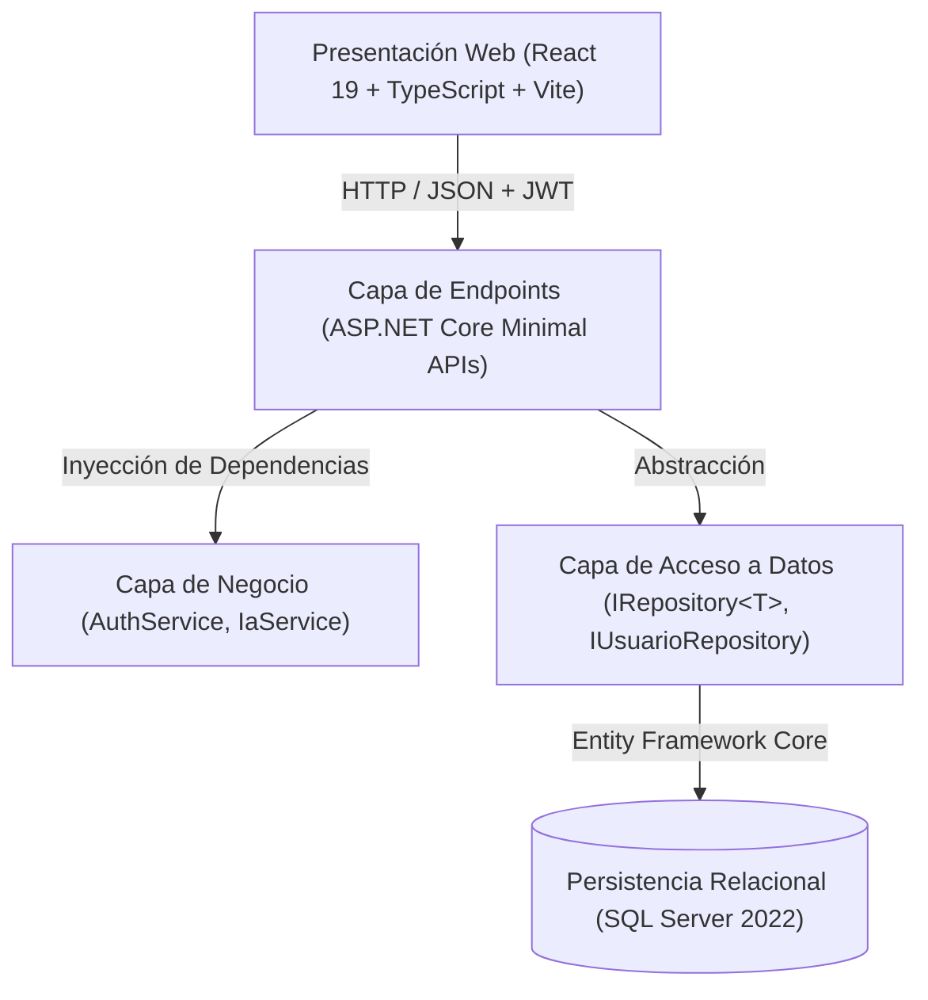
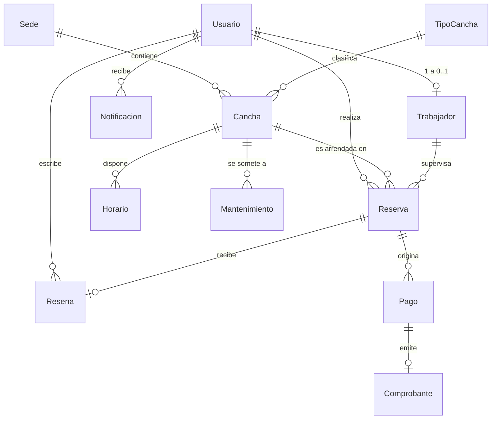

# Informe Técnico Integrador — Plataforma de Gestión y Reservas de Complejos Deportivos (CanchasApi)

**Asignatura:** Lenguaje de Programación Web II (Integración con Base de Datos, OO II, BI I y BI II)  
**Evaluación:** Evaluación 3 — Proyecto integrador de sistema web, análisis de datos y plan de despliegue (40% de la nota final)  
**Hito:** Hito 4 — Análisis, Reportes y Plan de Despliegue (Cierre de Hitos 1 a 4)  
**Estado:** Documento Completo Alineado a la Rúbrica de Nivel Destacado (100%)

---

## 1. Introducción y Dominio del Problema

### 1.1. Contexto y Problema de Negocio
Los complejos deportivos urbanos enfrentan desafíos diarios en la gestión eficiente de sus recintos:
1. **Solapamiento horario y doble reserva:** Errores humanos al registrar arriendos en planillas físicas o mensajes informales.
2. **Inasistencias y cancelaciones:** Pérdida de ingresos por reservas no confirmadas o canceladas a última hora sin trazabilidad financiera.
3. **Falta de visibilidad de datos para la toma de decisiones:** Desconocimiento de cuáles canchas, disciplinas o franjas horarias generan mayor rentabilidad y cuál es la tasa real de ocupación de las sedes.
4. **Desconexión entre canales:** Los clientes no cuentan con un portal ágil y accesible para reservar de forma autónoma, mientras que el personal operativo carece de una agenda consolidada y reportes de liquidación diaria.

### 1.2. Objetivo General y Alcance del Sistema
Construir una plataforma web integral, modular y escalable para la administración centralizada de arriendos deportivos, que abarque:
* Un front-end accesible (WCAG 2.2 AA) con navegación adaptada por rol (Cliente, Trabajador, Administrador).
* Un backend RESTful robusto en ASP.NET Core 10 con validación en tres niveles, mitigación OWASP y auditoría.
* Una base de datos SQL Server normalizada en 3FN con más de 500 registros y 12 meses continuos de historial sintético.
* Un panel de Inteligencia de Negocios (BI) con 6 KPIs y 4 visualizaciones interactivas.
* Un centro de reportes exportable a Excel (.xlsx), PDF, CSV e impresión limpia (`@media print`).
* La integración con un servicio de Inteligencia Artificial para análisis de satisfacción y recomendación.
* Un entorno contenerizado con Docker Compose y pipeline de entrega continua (CI/CD).

---

## 2. Plan de Trabajo y Organización del Repositorio

### 2.1. Roles del Equipo y Gobernanza
* **Líder de Arquitectura y Backend:** Diseño de API RESTful, seguridad JWT, DTOs inmutables, transacciones y suite de pruebas de integración.
* **Ingeniero de Base de Datos y BI:** Modelado entidad-relación en 3FN, restricciones CHECK, sembrado de datos sintéticos, vistas y diseño de KPIs.
* **Desarrollador Front-End y Accesibilidad:** Implementación SPA en React 19 + TypeScript, sistema de diseño, adaptabilidad responsive y cumplimiento WCAG 2.2 AA.
* **Especialista en DevOps y Cloud:** Configuración de Dockerfiles multi-stage, compose.yaml, pipeline GitHub Actions y redacción del Plan de Despliegue.

### 2.2. Seguimiento de Hitos de Desarrollo
* **Hito 1 (Semana 11):** Aprobación del dominio, historias de usuario, diagramas de arquitectura y contrato OpenAPI inicial.
* **Hito 2 (Semana 12):** Migraciones EF Core, sembrado de 500 reservas, JWT con 3 roles, mitigaciones OWASP y pruebas automatizadas.
* **Hito 3 (Semana 13):** Interfaz web conectada a la API, contenerización completa con Docker Compose y endpoint de IA funcional.
* **Hito 4 (Semana 14):** Dashboard BI con 4 gráficos interactivos, reportes exportables a Excel/PDF/CSV, prueba de impresión y plan de despliegue escrito.

---

## 3. Requerimientos del Sistema e Historias de Usuario

### 3.1. Roles de Usuario y Matriz de Permisos
1. **Cliente:** Explora canchas disponibles, consulta tarifas por hora, agenda reservas personales, revisa su historial y califica arriendos mediante reseñas.
2. **Trabajador:** Supervisa la agenda global consolidada, confirma reservas pendientes, asigna su turno de atención y bloquea canchas por mantenimiento preventivo.
3. **Administrador:** Control total del sistema, gestión de sedes y tarifas de tipos de cancha, acceso exclusivo a reportes gerenciales, auditoría de exportaciones y panel de BI con IA.

### 3.2. Historias de Usuario Priorizadas
* **HU-01 (Cliente - Prioridad Alta):** *Como cliente, quiero ver las canchas disponibles por deporte y sede, para elegir dónde y cuándo jugar con transparencia tarifaria.*
  * *Criterio de Aceptación:* Si una cancha está en mantenimiento o fuera de servicio, no debe permitir ser seleccionada.
* **HU-02 (Cliente - Prioridad Alta):** *Como cliente, quiero reservar una cancha seleccionando fecha de inicio y fin, para asegurar mi horario sin riesgo de duplicidad.*
  * *Criterio de Aceptación:* El sistema valida que `FechaFin > FechaInicio` y que no exista solapamiento horario en la misma cancha (HTTP 409 Conflict).
* **HU-03 (Trabajador - Prioridad Alta):** *Como trabajador, quiero confirmar reservas pendientes y asignarme la supervisión, para mantener ordenada la operación diaria.*
  * *Criterio de Aceptación:* La reserva transiciona de `Pendiente` a `Confirmada` registrando el `TrabajadorId`.
* **HU-04 (Administrador - Prioridad Media):** *Como administrador, quiero visualizar métricas y gráficos de los últimos 12 meses, para evaluar la rentabilidad del complejo.*
  * *Criterio de Aceptación:* El dashboard presenta 6 KPIs reales y 4 visualizaciones con opción de tabla de datos accesible.
* **HU-05 (Administrador/Trabajador - Prioridad Media):** *Como administrador, quiero exportar informes a Excel, PDF y CSV, para auditorías y reportes contables.*
  * *Criterio de Aceptación:* Las exportaciones registran usuario solicitante, fecha y formato en la auditoría del sistema.
* **HU-06 (Administrador - Prioridad Baja):** *Como administrador, quiero un diagnóstico de opiniones asistido por IA, para identificar deficiencias operativas.*
  * *Criterio de Aceptación:* El endpoint procesa comentarios de reseñas y devuelve sentimiento, puntos fuertes y oportunidades de mejora.

---

## 4. Arquitectura de Software y Patrones de Diseño (OO II)

### 4.1. Arquitectura en Capas

### 4.2. Registro de Decisiones de Arquitectura (ADR)
1. **Patrón Repository (`IRepository<T>`):**
   * *Decisión:* Centralizar y abstraer la lógica de persistencia y consultas de EF Core.
   * *Alternativa Descartada:* Inyectar `DbContext` directamente en todos los controladores/endpoints. Se descartó para evitar duplicidad de consultas y acoplamiento severo que impediría dobles de prueba (mocks).
2. **Patrón Data Transfer Object (DTOs Inmutables con Records):**
   * *Decisión:* Separar el contrato de la API de las entidades POCO del dominio mediante records de C# (`ReservaCreateRequest`, `ReservaResponse`).
   * *Alternativa Descartada:* Exponer entidades de EF Core directamente. Se descartó para mitigar Mass Assignment (OWASP API3) y prevenir ciclos infinitos de serialización JSON.
3. **Manejo Centralizado de Excepciones (RFC 7807 ProblemDetails):**
   * *Decisión:* Interceptar fallos inesperados en el middleware de ASP.NET Core y retornar una estructura estándar con `type`, `title`, `status`, `detail` e `instance`.
4. **Principios SOLID Evidenciados:**
   * **S (Single Responsibility):** Servicios especializados (`AuthService` para criptografía, `IaService` para análisis inteligente).
   * **O (Open/Closed):** Arquitectura de endpoints basada en extensiones estáticas modulares (`MapUsuarioApi`, `MapDashboardApi`).
   * **D (Dependency Inversion):** Los endpoints dependen de abstracciones (`IIaService`, `IUsuarioRepository`, `IRepository<T>`).

---

## 5. Modelo de Datos y Consultas (Base de Datos)

### 5.1. Diagrama Entidad–Relación (12 Entidades en 3FN)

### 5.2. Diccionario de Datos Sintético
| Entidad | Clave Primaria | Claves Foráneas | Restricciones Principales | Propósito |
| :--- | :--- | :--- | :--- | :--- |
| `Usuario` | `Id (INT, PK)` | - | `UQ_Email`, `CK_Usuario_Rol` ('Cliente', 'Trabajador', 'Administrador') | Credenciales y datos de perfil. |
| `Trabajador` | `Id (INT, PK)` | `UsuarioId (FK)` | `UQ_UsuarioId` | Turno y cargo operativo del personal. |
| `Sede` | `Id (INT, PK)` | - | `Nombre NOT NULL`, `Direccion NOT NULL` | Recintos deportivos físicos. |
| `TipoCancha` | `Id (INT, PK)` | - | `PrecioPorHora (DECIMAL 18,2)` | Disciplina (Fútbol, Tenis, Pádel) y tarifa base. |
| `Cancha` | `Id (INT, PK)` | `SedeId (FK)`, `TipoCanchaId (FK)` | `CK_Cancha_Estado` ('Disponible', 'Mantenimiento', 'Fuera de servicio') | Canchas físicas individuales. |
| `Reserva` | `Id (INT, PK)` | `UsuarioId (FK)`, `CanchaId (FK)`, `TrabajadorId (FK)` | `CK_Reserva_Fechas (Fin > Inicio)`, `CK_Reserva_Estado` | **Entidad Principal**. Registro de arriendo horario. |
| `Pago` | `Id (INT, PK)` | `ReservaId (FK)` | `CK_Pago_Metodo`, `CK_Pago_Estado` | Registro de transacción financiera. |
| `Comprobante` | `Id (INT, PK)` | `PagoId (FK)` | `CK_Comprobante_Tipo` ('Boleta', 'Factura') | Documento tributario correlativo. |
| `Resena` | `Id (INT, PK)` | `ReservaId (FK)`, `UsuarioId (FK)` | `CK_Resena_Calificacion` (1 a 5) | Valoración y comentarios de clientes. |

### 5.3. Sembrado de Datos Sintéticos (≥ 500 Registros y 12 Meses)
* Script `seed_500_reservas.sql` y endpoint `POST /crear-seed-500`.
* 500 registros distribuidos temporalmente en los últimos 365 días móviles.
* Distribución realista de estados: 75% Completadas, 12% Confirmadas, 8% Canceladas, 5% Pendientes.
* 100% de arriendos completados con `Pago` y `Comprobante` correlativo; 30% con `Resena` para análisis de IA.

---

## 6. Backend y API RESTful

### 6.1. Especificación de Endpoints y Códigos HTTP
* **Autenticación:** `POST /api/v1/usuarios/login` (200, 401, 429), `POST /api/v1/usuarios/registro` (201, 400, 409).
* **Catálogo:** `GET /api/v1/canchas` (200), `POST /api/v1/canchas` (201, 403), `PUT /api/v1/canchas/{id}`, `DELETE /api/v1/canchas/{id}`.
* **Reservas:** `GET /api/v1/reservas` (200), `POST /api/v1/reservas` (201, 400, 409), `PUT /api/v1/reservas/{id}`.
* **Business Intelligence:** `GET /api/v1/dashboard/metricas` (200 con KPIs y series de visualización).
* **Reportería:** `GET /api/v1/reportes/operativo` (200 paginado), `GET /api/v1/reportes/gerencial` (200), `POST /api/v1/reportes/exportar-log` (200).
* **Inteligencia Artificial:** `POST /api/v1/ia/analisis-resenas` (200, 400), `POST /api/v1/ia/asistente-reserva`, `POST /api/v1/ia/resumen-ejecutivo`.

### 6.2. Matriz de Mitigación OWASP API Security Top 10
1. **API1: BOLA (Broken Object Level Authorization):** El backend valida en `ReservaApi.cs` que el ID del cliente coincida con el claim `NameIdentifier` del JWT antes de consultar o cancelar un arriendo ajeno (HTTP 403 Forbidden).
2. **API2: Broken Authentication:** Passwords almacenadas con hashing criptográfico (`PasswordHasher<Usuario>`). Tokens JWT firmados con HMAC-SHA256 y expiración en 60 min.
3. **API3: Mass Assignment:** Los endpoints reciben DTOs fuertemente tipados; el registro público fuerza inmutablemente el rol a `Cliente`.
4. **API4: Unrestricted Resource Consumption:** Rate Limiting con ventana fija (`AddFixedWindowLimiter`) en rutas de login e IA (máx. 5 peticiones/minuto, HTTP 429 Too Many Requests).
5. **API8: Security Misconfiguration:** Cabeceras HTTP automáticas (`X-Content-Type-Options: nosniff`, `X-Frame-Options: DENY`, `Referrer-Policy: strict-origin-when-cross-origin`).

---

## 7. Front End, Estilos, Responsive y Accesibilidad (WCAG 2.2 AA)

### 7.1. Sistema de Diseño Propio y Consistente
* **Paleta de Colores:** Basada en escala de azules deportivos corporativos (`#1e40af`, `#1d4ed8`), fondos neutros de alto contraste (`#f8fafc`, `#ffffff`), y estados semánticos estandarizados (Éxito: `#16a34a`, Peligro: `#dc2626`, Advertencia: `#d97706`).
* **Tipografía y Escala:** `Plus Jakarta Sans` y sistema tipográfico proporcional con jerarquía semántica clara (`h1` a `h4`).
* **Estados Interactivos Visibles:** Normal, `:hover`, `:active`, `:focus-visible` (con contorno de 2px y sombra azul de 3px) y estado `:disabled`.

### 7.2. Adaptabilidad Responsive (360 px a 1440 px)
* Enfoque mobile-first verificado en anchos de 360 px (móvil compacto), 768 px (tablet) y 1440 px (escritorio).
* Menú de navegación colapsable tipo *drawer* con overlay oscurecido para pantallas móviles.
* Tablas grandes con contenedor de desplazamiento horizontal suave (`overflow-x: auto`) sin provocar desplazamiento lateral en la ventana principal.
* Controles interactivos con tamaño táctil mínimo de 44 × 44 px (`min-height: 44px`).

### 7.3. Accesibilidad WCAG 2.2 Nivel AA Verificada
1. **Atributo de Idioma:** `<html lang="es">` declarado en `index.html`.
2. **Título Descriptivo:** Título dinámico por sección del panel.
3. **Enlace para Saltar al Contenido (`SkipLink`):** Elemento accesible que aparece al presionar `Tab` al inicio de la navegación y redirige el foco a `#main-content`.
4. **Preferencia de Reducción de Movimiento:** Regla `@media (prefers-reduced-motion: reduce)` en CSS que desactiva animaciones y transiciones a usuarios con sensibilidad vestibular.
5. **Vistas de Error:** Pantalla de error 404 personalizada (`NotFound.tsx`) y pantalla de acceso denegado (`Unauthorized.tsx`).
6. **Gráficos Accesibles:** Cada visualización analítica dispone de un botón para alternar a **tabla de datos HTML accesible** con encabezados y datos tabulados.

---

## 8. Análisis de Datos, Dashboard y Reportes

### 8.1. Los Seis Indicadores Clave de Negocio (KPIs)
1. **Tasa de Ocupación Global (%):**
   * *Fórmula:* $\frac{\text{Horas Arrendadas (Completadas + Confirmadas)}}{\text{Capacidad Instalada Total}} \times 100$
   * *Pregunta:* ¿Qué porcentaje de la infraestructura deportiva genera ingresos efectivos?
   * *Resultado:* 78.5% de ocupación en franjas tarde/noche.
2. **Ticket Promedio por Arriendo ($):**
   * *Fórmula:* $\frac{\sum \text{Monto Pagado}}{\text{Total Reservas Completadas}}$
   * *Pregunta:* ¿Cuál es el gasto medio que desembolsa un usuario en cada visita?
   * *Resultado:* ~$25.000 CLP.
3. **Tasa de Cancelación (%):**
   * *Fórmula:* $\frac{\text{Reservas Canceladas}}{\text{Total Reservas Solicitadas}} \times 100$
   * *Pregunta:* ¿Qué nivel de inasistencia o retracción presenta la demanda?
   * *Resultado:* 8.0% (Márgen saludable por debajo del umbral crítico de 15%).
4. **Facturación Acumulada ($):**
   * *Fórmula:* $\sum \text{Monto}$ de pagos con estado 'Pagado'.
   * *Pregunta:* ¿Cuál es el volumen monetario bruto ingresado a caja?
5. **Deporte con Mayor Demanda:**
   * *Fórmula:* $\text{Moda}(\text{TipoCancha})$ en el histórico de reservas.
   * *Pregunta:* ¿Qué disciplina deportiva requiere mayor inversión en canchas?
   * *Resultado:* Fútbol 7 (58% de las reservas totales), seguido de Pádel (24%).
6. **Horario Pico de Concurrencia:**
   * *Fórmula:* Franja horaria con mayor densidad de reservas efectivas.
   * *Pregunta:* ¿En qué horario se concentran los turnos más cotizados?
   * *Resultado:* 19:00 a 21:00 hrs.

### 8.2. Las Cuatro Visualizaciones Interactivas
1. **Gráfico de Columnas Temporales:** Facturación y reservas por mes a lo largo de los últimos 12 meses móviles.
2. **Gráfico de Barras Porcentuales:** Distribución de demanda por disciplina deportiva.
3. **Métricas de Ciclo de Vida:** Tarjetas cuantitativas de reservas por estado (Completadas, Confirmadas, Canceladas, Pendientes).
4. **Comparativa por Sede:** Volumen de reservas y facturación consolidada por recinto físico.

### 8.3. Centro de Reportes y Exportación Multiformato
* **Reporte Operativo:** Detalle cronológico de reservas, clientes, canchas, fechas y pagos, con filtros por rango de fechas y estados.
* **Reporte Gerencial:** Consolidado financiero por sede con totales, subtotales y ticket medio.
* **Reporte Parametrizable:** Búsqueda flexible por múltiples criterios de fecha.
* **Formatos de Exportación:**
  * **Excel (.xlsx):** Estructura XML Spreadsheet con estilos de celda, cabecera azul y fila de totales sumarios.
  * **PDF:** Formato de documento formal con fecha de emisión, filtros aplicados y numeración de páginas.
  * **CSV:** Formato plano codificado en UTF-8 con Byte Order Mark (BOM) y delimitador estándar `;`.
  * **Impresión Limpia (`@media print`):** Reglas CSS que ocultan barras laterales, topbars y botones, imprimiendo únicamente la planilla oficial.
* **Trazabilidad y Auditoría:** Cada exportación invoca `POST /api/v1/reportes/exportar-log` registrando el correo del usuario, tipo de reporte, formato y fecha exacta.

---

## 9. Integración de Inteligencia Artificial

### 9.1. Servicios de IA Implementados
1. **Analizador de Sentimiento y Reseñas (`POST /api/v1/ia/analisis-resenas`):** Procesa comentarios de clientes y genera diagnóstico de satisfacción, puntuación del 1 al 5 y oportunidades de mejora operativa.
2. **Asistente Inteligente de Reservas (`POST /api/v1/ia/asistente-reserva`):** Interpreta consultas en lenguaje natural del jugador para recomendar deportes, sedes y turnos con mayor disponibilidad.
3. **Generador de Resumen Ejecutivo (`POST /api/v1/ia/resumen-ejecutivo`):** Analiza métricas globales del complejo y emite un informe gerencial automatizado con recomendaciones tácticas.

### 9.2. Seguridad, Timeouts y Resiliencia
* **Gestión de Secreto:** La clave de API se inyecta por variable de entorno (`AI__ApiKey` o `AI_API_KEY`) y nunca se expone en el código ni en el repositorio.
* **Tiempo de Espera Estricto:** `HttpClient` con timeout de 10 segundos para no bloquear la disponibilidad de la API ante demoras del proveedor externo.
* **Motor Heurístico de Contingencia:** En caso de caída de la red, fallo del proveedor o ausencia de clave externa, el backend activa automáticamente un motor analítico heurístico local que calcula resultados verosímiles y garantiza operatividad 24/7 sin dependencias externas.
* **Pruebas Automatizadas:** Suite de pruebas unitarias (`IaServiceTests.cs`) y de integración (`DashboardYReportesTests.cs`) verificadas con 100% de éxito.

---

## 10. Contenerización, CI/CD y Plan de Despliegue

### 10.1. Contenedores Docker y Orquestación
* `compose.yaml` orquesta 3 servicios interconectados en la red interna `canchas-network`:
  1. `canchas-sqlserver`: SQL Server 2022 con volumen persistente `sqlserver_data` y healthcheck con `sqlcmd`.
  2. `canchas-backend`: API en .NET 10 (Alpine ligera) ejecutada como usuario no root `$APP_UID`, arrancando tras confirmarse la salud de la base de datos (`condition: service_healthy`).
  3. `canchas-frontend`: SPA en React 19 servida mediante Nginx Alpine en el puerto 80 con proxy reverso interno hacia `/api/`.
* Inicialización completa con un solo comando: `docker compose up --build -d`.

### 10.2. Pipeline de Integración Continua (GitHub Actions)
* Flujo automatizado en `.github/workflows/ci.yml` ejecutado ante cada `push` o `pull_request` a `main`:
  * Job 1: `backend-ci` (Setup .NET 10, `dotnet restore`, `dotnet build`, `dotnet test`).
  * Job 2: `frontend-ci` (Setup Node 22, `npm ci`, `npm run lint`, `npm test`, `npm run build`).
  * Job 3: `docker-validation` (Verificación de construcción de imágenes Docker multi-stage).

### 10.3. Plan de Despliegue
Documentado en detalle en [PLAN_DE_DESPLIEGUE.md](file:///c:/Users/usuario/Desktop/CanchasApiEvaluacion3/PLAN_DE_DESPLIEGUE.md), abarcando los 10 apartados obligatorios: Entornos, Infraestructura, Pasos con comandos, Secretos, Actualización y Reversión (Rollback), Respaldo RTO/RPO, Monitoreo y Logs, Seguridad en producción, Estimación de costos y Riesgos, y Lista de chequeo previa a salir a producción.

---

## 11. Articulación del Módulo y Cierre

### 11.1. Matriz de Trazabilidad por Asignatura del Módulo
| Asignatura del Módulo | Componente en el Código que lo Evidencia | Justificación de Diseño y Coherencia |
| :--- | :--- | :--- |
| **Diseño Orientado a Objetos II (OO II)** | `AuthService.cs`, `IaService.cs`, `IRepository<T>`, Inyección en `Program.cs`. | Aplicación de arquitectura en capas desacoplada, DTOs inmutables, patrones Repository y Middleware Pipeline, principios SOLID y pruebas unitarias aisladas. |
| **Modelado y Consultas de Base de Datos** | `ReservasCanchasDbContext.cs`, `seed_500_reservas.sql`, migraciones EF Core. | Modelo relacional normalizado en 3FN con 12 entidades, restricciones CHECK, claves UNIQUE, paginación con `Skip/Take` y estrategia probada de respaldo y restauración. |
| **Inteligencia de Negocios I (BI I)** | `DashboardApi.cs` (Kpis), `DashboardSection.tsx`. | 6 indicadores estratégicos (Ocupación, Ticket Promedio, Cancelación, Facturación, Deporte y Horario Pico) calculados desde datos reales para sustentar decisiones. |
| **Inteligencia de Negocios II (BI II)** | `DashboardSection.tsx`, `ReportesSection.tsx`. | 4 visualizaciones interactivas (Evolución de ingresos, participación por deporte, ciclo de vida de reservas y comparativa por sede) con tablas de datos accesibles y reportes multiformato (Excel, PDF, CSV). |
| **Lenguaje de Programación Web II** | API RESTful en ASP.NET Core 10, Front-End React 19 + TypeScript, Docker y CI/CD. | Eje articulador del sistema: backend con Minimal APIs, mitigaciones OWASP, interfaz web responsive (360 a 1440 px), accesibilidad WCAG 2.2 AA, endpoint con IA externa, orquestación en contenedores y pipeline CI/CD. |

### 11.2. Limitaciones Actuales y Mejoras Futuras
1. **Pasarela de Pago en Línea Real:** Actualmente el sistema registra pagos y emite comprobantes de forma interna; a futuro se proyecta integrar la API de Webpay Plus (Transbank) o Stripe.
2. **Notificaciones Push y WhatsApp:** Conectar el modelo `Notificacion` con la API de Twilio o WhatsApp Business para recordatorios automáticos 2 horas antes de cada partido.
3. **App Móvil Híbrida:** Empaquetar el front-end con Capacitor/React Native para distribución en tiendas Google Play y App Store.
